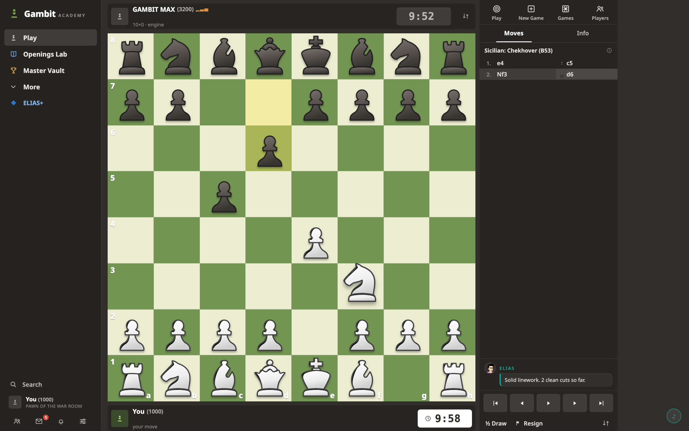
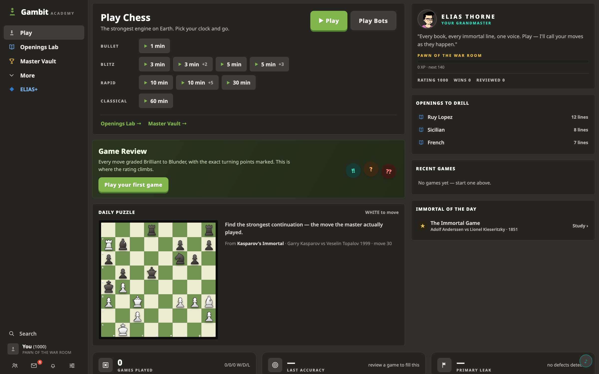

# Grandmaster Lab

**A chess app designed to take you to grandmaster — by making every game hyper-personalised, so you learn on the go.**

You don't get better at chess by playing anonymous games. You get better when every move you make is graded, explained, and turned into a lesson — while you're still in the position. That's what this is: a full chess workspace where a max-strength Stockfish plays you, a grandmaster coach watches every move, narrates your game out loud, and walks you through exactly what to fix the moment it's over.



## How it teaches you

### Every game is a lesson
- **Stockfish WASM at maximum strength** (Skill 20, thinking on your own clock) — bullet 1+0 to classical 60+0
- Premoves, capture trays with material count, live clocks, and a real Elo rating that moves with every result
- **The coach calls your moves as they happen** — light engine probes grade each move in real time, and Elias Thorne reacts out loud (speech synthesis) and in the chat strip: hype when you're flowing, fire when you blunder, calm when you're winning

### Every review is a debrief
- The moment your game ends, a full review opens: **accuracy %, average centipawn loss, every move classified** — Brilliant, Great, Best, Excellent, Good, Book, Inaccuracy, Mistake, Blunder, Forced
- Eval bar + clickable eval graph with mistake dots, best-move arrows, engine lines
- **Category walkthrough**: step through every Brilliant, every Blunder, everything in between — and Elias narrates each step aloud
- Coaches you on *your* side of the board: the review is personalised to the color you played

### Every opening is drilled, not memorised
- **Openings Lab**: 145 validated ECO lines with instant book-move validation
- Learn mode shows the expected move; Pro mode rejects slips

### Every immortal is a lesson
- **Master Vault**: Opera Game, Immortal Game, Byrne–Fischer 1956, Fischer–Spassky 1972 Game 6, Kasparov–Topalov 1999 — hand-verified scores
- Ask the engine about any position while you step through history

### Progress that compounds
- XP, 11 rank titles (Pawn of the War Room → Thorne's Equal), 12 badges, Elo with peak tracking, cross-game classification history
- Daily puzzle mined from the immortal games



## Stack

- React 19 + TypeScript + Vite
- [chess.js](https://github.com/jhlywa/chess.js) for rules
- [Stockfish](https://github.com/nmrugg/stockfish.js) WASM in Web Workers (gameplay + a live coach probe)
- Web Speech API for the coach's voice (British male voice when available, mute toggle)
- Hand-rolled board renderer (drag/click, premove arrows, animations, captured trays)
- Everything persists in `localStorage` — no backend, no accounts, no telemetry

## Run it

```bash
npm install
npm run dev        # http://localhost:5173
npm run build      # production build in dist/
```

## Repository tools

```bash
node scripts/sweep.mjs             # 22 interaction tests in a real browser (Playwright)
node scripts/leak-check.mjs        # memory/storage leak regression over full game cycles
node scripts/validate-openings.mjs # validate all ECO lines parse
node scripts/validate-masters.mjs  # validate master game scores
node tools/render-set.mjs <set>    # swap the piece set from tools/sets/<set>/*.svg
```

The browser suites need `npx playwright install chromium` once.

## Credits

- **Stockfish** — the engine, via [nmrugg/stockfish.js](https://github.com/nmrugg/stockfish.js) (GPL). Built by the Stockfish developers.
- **Piece sets** — "Staunty" and "Companion" from the [Lichess open-source project](https://github.com/lichess-org/lila/tree/master/public/piece) (lichess.org). Non-commercial use with attribution; see the license notes in the lila repository.
- **Move/capture sounds** — from the [Lichess sound set](https://github.com/lichess-org/lila/tree/master/public/sound/standard).
- **Coach portrait** — [Open Peeps](https://www.openpeeps.com/) by Pablo Stanley (CC0, public domain), generated via DiceBear.
- **Noto Sans** — Google Fonts (OFL).
- **chess.js** — BSD-2-Clause.

## License

GPL-3.0 — required by the bundled Stockfish engine. See [LICENSE](LICENSE).

Full asset attributions in [CREDITS.md](CREDITS.md). Not affiliated with chess.com.
